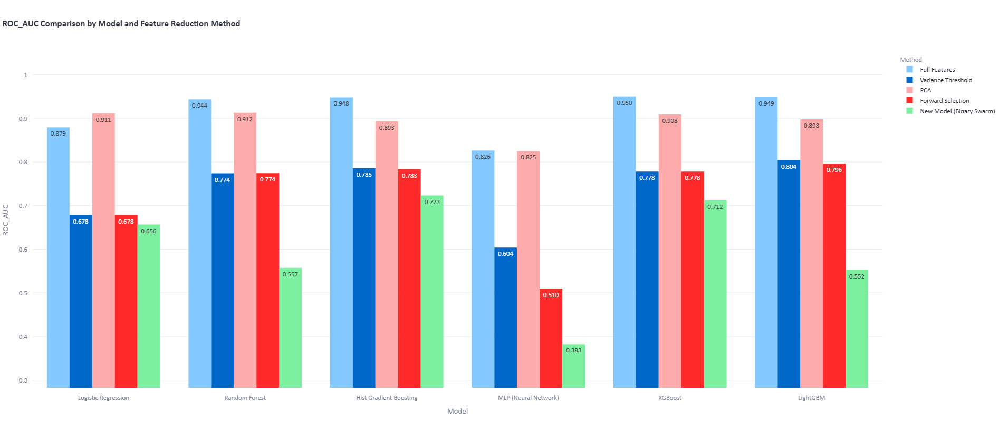
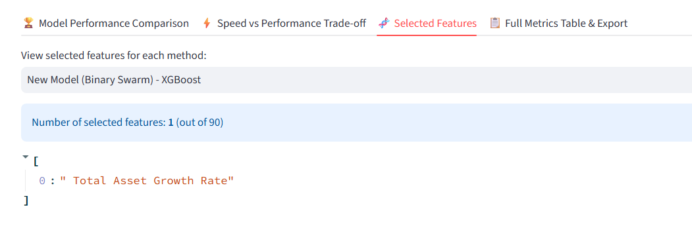
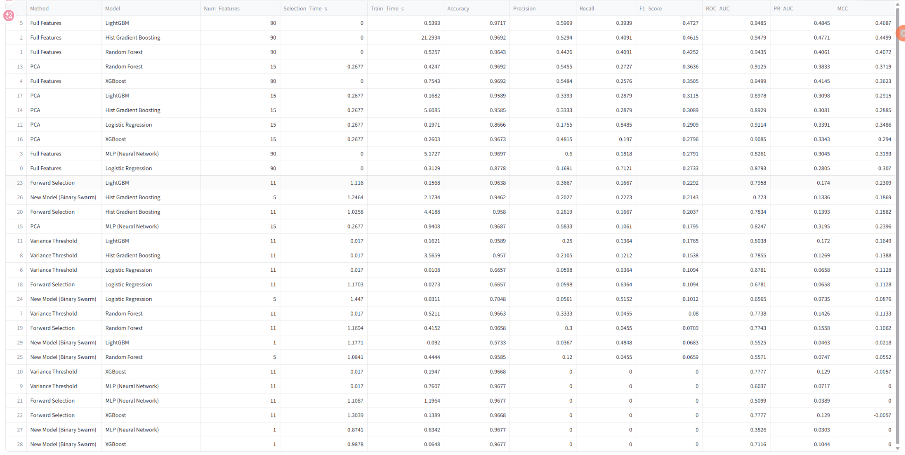

# ⚡ Financial Risk & Dynamic Feature Reduction Studio

An end-to-end Machine Learning & Business Analytics web application designed to automate data preprocessing, eliminate redundant financial features, and benchmark modern classification models.

🔗 **Live Web Application:** [feature-reduction-studio.streamlit.app](https://feature-reduction-studio.streamlit.app/)

---

## 💼 Business Case Study: Corporate Bankruptcy Prediction

In financial risk modeling and credit scoring, datasets often contain dozens of overlapping accounting ratios (multicollinearity). Collecting and computing all features increases operational cost and causes model overfitting.

Using the **Taiwanese Company Bankruptcy Prediction** dataset (**6,819 companies, 95 financial indicators**), this platform demonstrates how automated feature reduction extracts the most critical financial health signals:

* **Dimensionality Reduction:** Reduced financial variables by **~85% (from 95 features down to 10–15 core indicators)**.
* **Risk Discrimination (ROC-AUC):** Maintained high predictive power (**ROC-AUC ~ 0.90+**) across Gradient Boosting (XGBoost, LightGBM) and Neural Network models, comparable to using all 95 features.
* **Business Interpretability (For BA / DA):** Automatically isolated key financial drivers of bankruptcy—such as *Net Income to Total Assets*, *Debt Ratio %*, *Persistent EPS in the Last Four Seasons*, and *Borrowing Dependency*—enabling faster credit risk assessment.

---

## 🖥️ Experimental Results & Visuals

### 1. Model Performance Comparison (ROC-AUC Across Methods)

Comparing full financial indicators (95 features) against reduced subsets across industry-standard models:

  

### 2. Extracted Key Financial Drivers (Feature Interpretability)

Identifying the exact accounting ratios selected by the optimization algorithms for business reporting:

  

### 3. Comprehensive Evaluation Metrics & Runtime Benchmark

Full evaluation using industry metrics suited for skewed financial data (**ROC-AUC, PR-AUC, MCC, F1-Score**) alongside computational speed:

  

---

## 🛠️ Key System Architecture & Optimizations

1. **Universal Auto-Preprocessing Pipeline:** Dynamically handles unseen `.csv` or `.xlsx` datasets by performing median/mode imputation, one-hot encoding, and automatic removal of unique IDs/constants.
2. **Leak-Free Validation Split:** Enforces a strict `Train / Validation / Test` split so wrapper and heuristic searches never touch the final test set.
3. **High-Speed Custom Meta-Heuristics:** Implements a custom **Binary Swarm Optimizer** and **Genetic Algorithm** accelerated with **Numpy Vectorization**, **Parallel Processing (`joblib`)**, and **Early Stopping**.
4. **Two-Stage Hybrid & Surrogate Search:** Combines `VarianceThreshold` pre-filtering with fast surrogate evaluators (`GaussianNB`) to prevent computational bottlenecks on wide datasets.

---

## 🧰 Tech Stack

* **Feature Selection & Reduction:** Variance Threshold, Correlation Matrix, PCA, Forward Selection, Backward Elimination, Genetic Algorithm, Custom Binary Swarm Optimizer.
* **Machine Learning Models:** XGBoost, LightGBM, HistGradientBoosting, Extra Trees, Random Forest, MLP (Neural Network), SVM, KNN, Naive Bayes, Logistic Regression.
* **Evaluation Metrics:** ROC-AUC, PR-AUC, Matthews Correlation Coefficient (MCC), F1-Score, Precision, Recall, Accuracy.
* **Application & Visualization:** Python, Streamlit, Scikit-learn, Pandas, NumPy, Plotly, Joblib.
